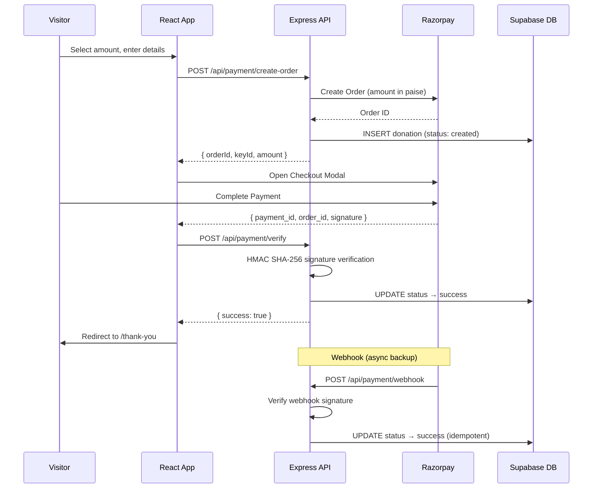

# ☕ Buy Me a Coffee

A modern, production-ready "Buy Me a Coffee" support page for developers. Built with React, Express, Razorpay, and Supabase.

> **Your support helps me keep building AI projects, experimenting with new technologies, and sharing what I learn.**


---

## ✨ Features

- **One-click donations** — Select from ₹1 to ₹1,000 or enter a custom amount
- **Secure payments** — Razorpay integration with server-side signature verification
- **No sign-up required** — Visitors donate instantly without creating an account
- **Optional supporter info** — Name, message, and anonymous option
- **Recent supporters** — Public wall of supporters with anonymization
- **Webhook support** — Razorpay webhooks for reliable payment status updates
- **Responsive design** — Mobile-first, works on all screen sizes
- **Premium UI** — Coffee-themed warm color palette, Inter font, smooth interactions

---

## 🏗️ Tech Stack

| Layer | Technology |
|-------|-----------|
| **Frontend** | React 19, Vite, TypeScript, Tailwind CSS v4, React Router, Lucide Icons |
| **Backend** | Node.js, Express, TypeScript, Helmet, CORS, Rate Limiting |
| **Database** | Supabase (PostgreSQL) |
| **Payments** | Razorpay (Orders API + Checkout.js + Webhooks) |
| **Deployment** | Frontend → Vercel, Backend → Render, Database → Supabase |

---

## 📐 Architecture



---

## 🗂️ Project Structure

```
buy-me-a-coffee/
│
├── frontend/                    # React + Vite + TypeScript
│   ├── src/
│   │   ├── components/          # Reusable UI components
│   │   │   ├── Hero.tsx
│   │   │   ├── AmountSelector.tsx
│   │   │   ├── SupporterForm.tsx
│   │   │   ├── PaymentButton.tsx
│   │   │   ├── DonationCard.tsx
│   │   │   ├── WhySupport.tsx
│   │   │   ├── RecentSupporters.tsx
│   │   │   ├── AboutMe.tsx
│   │   │   ├── Footer.tsx
│   │   │   └── Layout.tsx
│   │   ├── pages/               # Route pages
│   │   │   ├── HomePage.tsx
│   │   │   ├── ThankYouPage.tsx
│   │   │   └── PaymentFailedPage.tsx
│   │   ├── hooks/               # Custom React hooks
│   │   │   └── useRazorpay.ts
│   │   ├── services/            # API client
│   │   │   └── api.ts
│   │   ├── types/               # TypeScript types
│   │   │   ├── index.ts
│   │   │   └── razorpay.d.ts
│   │   ├── App.tsx
│   │   ├── main.tsx
│   │   └── index.css            # Design system (Tailwind v4)
│   ├── index.html
│   ├── vite.config.ts
│   └── package.json
│
├── backend/                     # Express + TypeScript
│   ├── src/
│   │   ├── config/              # Environment, Supabase, Razorpay
│   │   │   ├── env.ts
│   │   │   ├── supabase.ts
│   │   │   └── razorpay.ts
│   │   ├── controllers/         # Request handlers
│   │   │   ├── payment.controller.ts
│   │   │   └── donation.controller.ts
│   │   ├── services/            # Business logic
│   │   │   ├── payment.service.ts
│   │   │   └── donation.service.ts
│   │   ├── routes/              # Express routes
│   │   │   ├── payment.routes.ts
│   │   │   └── donation.routes.ts
│   │   ├── middleware/          # Rate limiting
│   │   │   └── rateLimiter.ts
│   │   ├── utils/               # Validation helpers
│   │   │   └── validation.ts
│   │   └── server.ts            # App entry point
│   ├── tsconfig.json
│   └── package.json
│
├── supabase/
│   └── migrations/
│       └── 001_create_donations_table.sql
│
├── .env.example
├── .gitignore
└── README.md
```

---

## 🚀 Local Development Setup

### Prerequisites

- Node.js 20+
- A [Razorpay](https://dashboard.razorpay.com/) account (test mode)
- A [Supabase](https://supabase.com/) project

### 1. Clone the Repository

```bash
git clone https://github.com/yourusername/buy-me-a-coffee.git
cd buy-me-a-coffee
```

### 2. Set Up Supabase

1. Create a new project at [supabase.com](https://supabase.com/)
2. Go to **SQL Editor** and run the migration:

```sql
-- Copy the contents of supabase/migrations/001_create_donations_table.sql
-- and execute it in the Supabase SQL Editor
```

3. Note your **Project URL** and **Service Role Key** from **Settings → API**

### 3. Set Up Razorpay

1. Create an account at [razorpay.com](https://razorpay.com/)
2. Go to **Settings → API Keys** and generate test keys
3. Go to **Settings → Webhooks** and add:
   - URL: `https://your-backend-url/api/payment/webhook`
   - Events: `payment.captured`, `payment.failed`
   - Note the webhook secret

### 4. Configure Environment Variables

```bash
cp .env.example backend/.env
```

Edit `backend/.env` with your actual credentials:

```env
RAZORPAY_KEY_ID=rzp_test_xxxxxxxxxxxxx
RAZORPAY_KEY_SECRET=your_key_secret
RAZORPAY_WEBHOOK_SECRET=your_webhook_secret
SUPABASE_URL=https://xxxxx.supabase.co
SUPABASE_SERVICE_ROLE_KEY=your_service_role_key
FRONTEND_URL=http://localhost:5173
PORT=5000
```

### 5. Start the Backend

```bash
cd backend
npm install
npm run dev
```

The API will be available at `http://localhost:5000`.

### 6. Start the Frontend

```bash
cd frontend
npm install
npm run dev
```

The app will be available at `http://localhost:5173`.

> The Vite dev server proxies `/api` requests to the backend automatically.

---

## 📡 API Endpoints

| Method | Endpoint | Description |
|--------|----------|-------------|
| `GET` | `/api/health` | Health check |
| `POST` | `/api/payment/create-order` | Create a Razorpay order |
| `POST` | `/api/payment/verify` | Verify payment signature |
| `POST` | `/api/payment/webhook` | Razorpay webhook handler |
| `GET` | `/api/donations/recent` | Get recent successful donations |

### Request/Response Format

```json
// Success
{ "success": true, "data": { ... } }

// Error
{ "success": false, "message": "Error description" }
```

---

## 🔒 Security

- **Razorpay Key Secret** — never exposed to the frontend
- **Supabase Service Role Key** — server-side only, bypasses RLS
- **Payment verification** — HMAC SHA-256 signature verification on every payment
- **Webhook verification** — Signature verification on all webhook events
- **Rate limiting** — 10 requests/minute on payment endpoints
- **Helmet** — Security headers on all responses
- **CORS** — Restricted to frontend origin
- **Input validation** — Amount (₹1–₹1,000), name (100 chars), message (200 chars)
- **Idempotent webhooks** — Duplicate payment events are safely ignored

---

## 🌐 Deployment

### Frontend → Vercel

1. Push to GitHub
2. Import the repository in [Vercel](https://vercel.com/)
3. Set **Root Directory** to `frontend`
4. Add environment variable:
   - `VITE_API_URL` = `https://your-backend.onrender.com`
5. Deploy

### Backend → Render

1. Create a **Web Service** on [Render](https://render.com/)
2. Set **Root Directory** to `backend`
3. Build Command: `npm install && npm run build`
4. Start Command: `npm start`
5. Add all environment variables from `.env.example`
6. Set `FRONTEND_URL` to your Vercel frontend URL
7. Deploy

### Database → Supabase

Already hosted — just run the migration SQL in the Supabase SQL Editor.

### Post-Deployment

- Update Razorpay webhook URL to your Render backend URL
- Switch from test to live Razorpay API keys for production
- Update `FRONTEND_URL` in Render to match your Vercel domain

---

## 💰 Payment Flow

```
User selects ₹50 → Clicks "Buy Me a Coffee"
       ↓
Frontend → POST /api/payment/create-order
       ↓
Backend validates → Creates Razorpay order → Inserts DB record (status: created)
       ↓
Frontend opens Razorpay Checkout modal
       ↓
User completes payment on Razorpay
       ↓
Frontend → POST /api/payment/verify (with signature)
       ↓
Backend verifies HMAC signature → Updates DB (status: success)
       ↓
Frontend redirects to /thank-you
       ↓
Razorpay → POST /api/payment/webhook (async backup)
       ↓
Backend verifies webhook signature → Idempotent DB update
```

---

## 🛣️ Future Improvements

- [ ] Email notifications on successful donations
- [ ] Admin dashboard for donation analytics
- [ ] Export donations to CSV
- [ ] Dark mode toggle
- [ ] Social sharing with OG image
- [ ] Donation goals / progress bars
- [ ] Multiple currency support
- [ ] Recurring donations

---

## 📝 License

MIT

---

<p align="center">
  Built with ❤️ and ☕ by <strong>Sarweshwar</strong>
</p>
